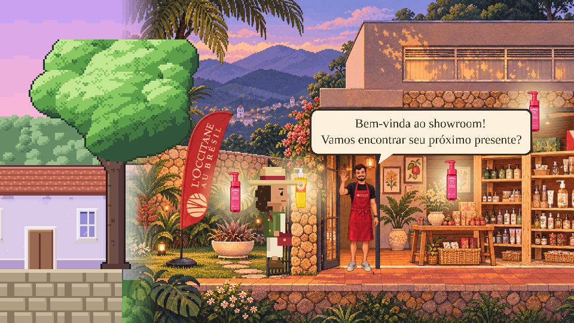
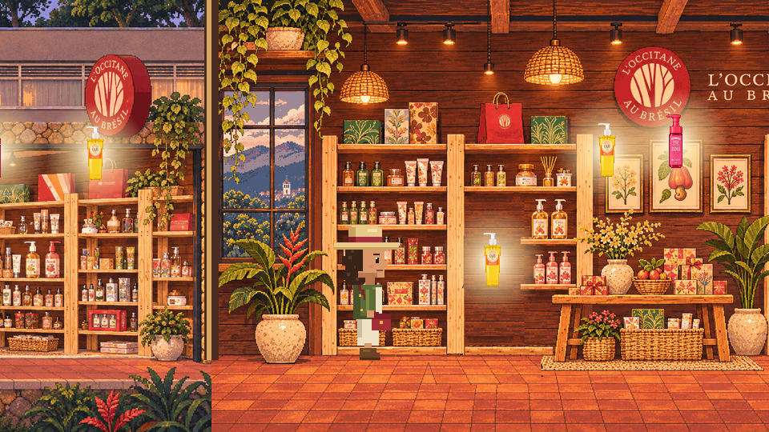
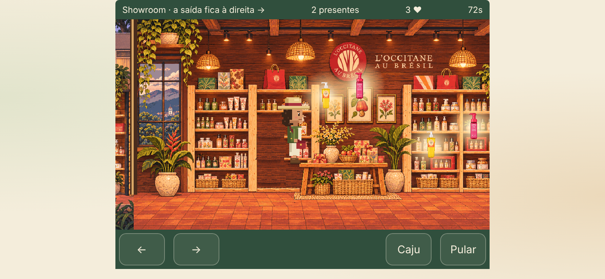

# Cena jogável do showroom

> **Atualização (17/11/2026):** a fachada agora é a arte fechada enviada pelo Pedro, com entrada pela porta, e fachada e interior são duas telas com transição. A mesa e as estantes da fachada descritas abaixo não existem mais; a caixa da fachada fica no alto da marquise (pula-se no toldo, que quica). Ver `docs/RODADA-AJUSTES.md`.

Data: 17/11/2026. A cena faz parte do percurso normal: depois da rua, a exploradora passa pelo jardim, entra pela porta (onde o Pedro a recebe), atravessa a sala dos presentes e sai pela direita, o que leva à tela final.

Capturas reais do jogo (canvas do Phaser, não são os conceitos):

## Como acessar e testar

1. `npm ci` e `npm run dev`; abra o endereço do Vite e clique em "Começar aventura".
2. O showroom começa na posição 5216 do mundo. Jogando sem errar, chega-se lá em cerca de 37 s; a partida inteira leva cerca de 42 s dos 75 s.
3. Atalho no modo de desenvolvimento, pelo console: `jogo.scene.getScene('Aventura').jogador.body.reset(5250, 240)`.
4. No showroom: pule na mesa de presentes para alcançar os produtos altos; na fachada, da mesa dá para subir no topo das estantes. A saída é a borda direita do interior.

## Como foi montada

- O mundo continua em unidades de 480×270. O canvas passou a 960×540 e a câmera usa zoom 2 na cidade (mesma aparência de antes) e zoom 3 no showroom. A aproximação começa 430 unidades antes da fachada, num trecho de rua sem obstáculos.
- Cada fundo ocupa 320×180 unidades (960×540 pixels de textura, 1 pixel de textura por pixel de tela). Com isso a exploradora fica com cerca de 30% da altura da tela, perto da proporção do conceito.
- Visual e colisão são separados: os fundos são imagens; a física é um piso invisível e três tampos que se atravessam por baixo (mesa da fachada, topo das estantes da fachada, mesa do interior). Medidas em `criarShowroom()` de `src/game/Aventura.js`, em pixels da arte original.
- Percurso encurtado de 8800 para 5856 unidades, com os lugares de Itajubá mais próximos, para o showroom caber com folga nos 75 s.

## Assets

| Asset | Situação |
| --- | --- |
| `references/propostas/showroom-pixel-art-moderno.png` | **Adaptado** → `public/assets/showroom/fachada.png`: exploradora da porta removida, reduzido a 960×540, 255 cores |
| `references/propostas/showroom-interior-exploradora-andando.png` | **Adaptado** → `public/assets/showroom/interior.png`: exploradora removida e a região reconstruída (parede de madeira, montante, base da estante, piso) |
| `public/assets/produtos/caju-sabonete-pixel-art.png` | **Adaptado** → `showroom/caju.png` (32×78), coletável |
| `public/assets/produtos/roma-chantilly-pixel-art.png` | **Adaptado** → `showroom/roma.png` (31×78), coletável |
| `public/assets/personagens/pedro-spritesheet.png` + atlas | **Reutilizado direto** (17/11, segunda rodada): Pedro parado, acena quando a exploradora chega e gesticula enquanto o balão está aberto |
| Cidade (`public/assets/cidade/`), capivara, física, controles, pausa, HUD, tela final | **Reutilizados** sem mudança |
| Exploradora | **Recriada em código** (`src/game/arte.js`) com 3× mais detalhe e o visual do conceito; continua provisória |
| Halo dos coletáveis, balão de fala, batente entre as salas | **Criados** em código |

Os originais não foram alterados. Os derivados saem de `python3 ferramentas/preparar_showroom.py . public/assets/showroom` (precisa do Pillow). As seis fotos reais serviram só de conferência de arquitetura; não entram no jogo.

## Testado (Chromium via Playwright, nesta máquina)

- `npm test`: 8 de 8. `npm run build`: passou.
- Partida completa por robô com teclado: cidade, fachada, mesa, topo das estantes, interior, mesa, saída e tela final em 42 s de jogo, 37 itens, nenhum dano, 4 capivaras alimentadas com caju. Reinício volta ao começo com zoom 2 e contador zerado.
- Console sem erros e nenhuma resposta 404.
- Pausa ao perder o foco: o tempo para e só volta com "Continuar".
- Toque emulado em 844×390 (dois dedos ao mesmo tempo, andar + pular): funcionou. 42 quadros por segundo no Chromium sem placa de vídeo; não é medida de celular.

## Não testado e limitações

- Nenhum aparelho real (Android/iPhone), nem áudio.
- A exploradora é desenhada em código e fica mais simples que o cenário; a capivara, as caixas e os presentes da rua são da base antiga e aparecem maiores e borrados perto do showroom. Pedido de spritesheets em `docs/PROMPT-SPRITES.md`.
- Pedro usa a spritesheet de 14 quadros (parado, aceno, conversa). O balão aparece sozinho quando a exploradora chega perto; não há interação por tecla. A folha é carregada em alta resolução (1,2 MB) e reduzida na tela.
- A região onde a exploradora foi removida do interior é um vão de parede de madeira sem produtos; na porta da fachada o fundo foi interpolado e fica atrás do Pedro.
- A emenda entre a cidade e a fachada é suavizada com faixas de transparência e uma árvore, mas os dois estilos de pixel são diferentes.
- O topo das estantes da fachada funciona como plataforma: a personagem fica na frente das sacolas desenhadas.
- O site não foi publicado. Oferta, contato e resgate continuam como estavam (resgate bloqueado, teto de 10%).
