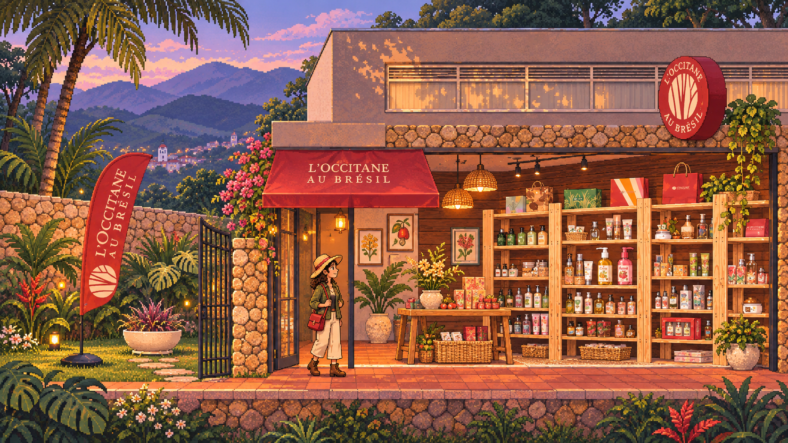

# Proposta visual do showroom

Conceito gerado a pedido do usuário, inspirado na atmosfera acolhedora de Magical Delicacy e nas fotos reais do showroom de Itajubá. Combina jardim, fachada de pedra, toldo vermelho, interior com estantes de madeira clara e a Mantiqueira ao fundo, em composição lateral com corte para o interior.

Os dois conceitos desta pasta são usados como fundo da cena jogável, em versões adaptadas (`public/assets/showroom/`, ver `docs/SHOWROOM-JOGAVEL.md`). Não representam reprodução arquitetônica exata. Ainda precisa de aprovação, revisão de marca e adaptação em camadas/tiles para gameplay. Não contém assets extraídos de Magical Delicacy.
